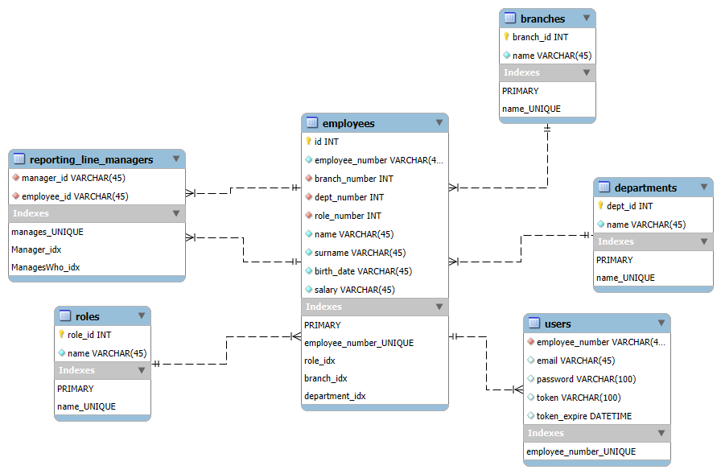
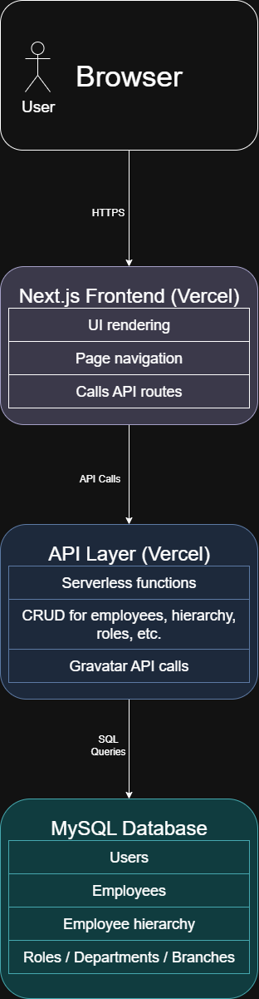

# **EPI-USE-Employee Hierarchy Management – Technical Document**
  

# **Architecture**:
## **1. Overview**

The EPI-USE-Employee Hierarchy Management Web App is a **Next.js** application with an **API layer hosted on Vercel** and a database hosted on an **Oracle VM** using a **MySQL server**.
  It provides tools for managing the organization’s employee hierarchy, roles, departments, and branches, along with user authentication and profile management via Gravatar.

---

## **2. System Components**

### **Frontend**

* **Framework**: Next.js (App Router)
* **Hosting**: Vercel
* **Main Features**:

  * **Authentication**: Login and register pages.
  * **Hierarchy View**:

    * Default home page view.
    * Interactive tree view with ability to search/edit hierarchy and view employee details/Gravatars.
  * **List View**:

    * Search and filter employees.
    * Edit employee details.
    * Remove employees from database.
  * **Management Pages**:

    * Manage employees (add).
    * Manage roles, departments, and branches (add/edit/delete).
  * **Profile Page**:

    * Displays user Gravatar.
    * Allows editing Gravatar via Gravatar API integration.

---

### **API Layer**

* **Platform**: Serverless API routes (Vercel/Next.js Functions)
* **Responsibilities**:

  * Handle CRUD operations for:

    * Employees
    * Hierarchy relationships
    * Roles
    * Departments
    * Branches
  * Authentication (login/register and session management)
  * Profile and Gravatar API integration
* **Security**:

  * Input validation before DB operations.

---

### **Database**

* **Platform**: MySQL database hosted on an Oracle Cloud VM (Linux)
* **Tables** (key examples):

  * `users`
  * `employees`
  * `reporting_line_managers`
  * `roles`
  * `departments`
  * `branches`
* **Purpose**:

  * Store persistent user, employee, and organizational data.
  * Maintain hierarchical relationships via `reporting_line_managers`.
* **EER-Diagram**

  

---

## **3. Data Flow**

1. **User Request** → Browser sends request to Next.js frontend.
2. **API Call** → Frontend fetches data from Vercel API routes.
3. **Database Query** → API route queries MySQL server.
4. **Response** → API returns JSON to frontend.
5. **UI Update** → Next.js renders updated UI (SSR/CSR).

---

## **4. Navigation Structure**

* **Login/Register** → `/login`, `/register`
* **Home** → `/`
* **Management** → `/management`

  * `/employees`
  * `/roles`
  * `/departments`
  * `/branches`
* **Profile** → `/profile`

## **5. Basic Architecture Diagram**

---
   
---

# **Design Patterns**:

## **Observer Pattern**

* The Observer Pattern is used to automatically update the UI when state changes occur.
* This is implemented through React hooks (`useState`, `useEffect`, and `useMemo`) that observe state changes and trigger UI updates accordingly.
* Example: Dark/light mode detection and responsive styling.

## **Command Pattern**

* The Command Pattern is applied by triggering functions in response to user actions.
* This happens through event listeners such as `onMouseDown` and other interaction handlers.
* Example: Drag-and-drop functionality in the hierarchy view.

## **Strategy Pattern**

* The Strategy Pattern is applied by dynamically choosing which component to render based on user interaction.
* This is done by switching the `view` state between `'hierarchy'` and `'list'`.
* Example: Rendering either the `EmployeeTree` or `EmployeeList` component on the home page depending on the selected view.

---
   
---

# **Technology choices**:
## **Frontend Framework**: Next.js (App Router)
* I chose Next.js for the Static Site Generation which works well in vercel.
* I chose to use the App Router for a clean project structure and the automatic routing that comes with it.
* API route integration allows for seamless communication between frontend and backend.
* It is React-based, so I can use the react ecosystem

## **Backend/API Hosting**: Vercel
* I chose Vercel for its seamless integration with GitHub, simplifying continuous deployment workflows.
* Its serverless functions automatically scale with demand, ensuring efficient resource usage.
* The stateless, event-driven nature of API routes allows for easy maintenance and cost-effective hosting.
* Vercel’s free tier provides preview and production domains, though it uses low-end server hardware, which can affect responsiveness. This is common among free-tier hosting options.
* While AWS offers more powerful infrastructure, its steep learning curve and my lack of prior experience made it impractical given the project’s time constraints.

## **Database**: MySQL hosted on an Oracle Cloud VM (Linux)
* The database is a **MySQL server hosted on an Oracle Cloud VM running Linux**.
* This approach was chosen primarily due to my familiarity with MySQL and the flexibility offered by hosting it on an Oracle VM.  Unlike many free-tier managed MySQL hosting services, the Oracle Cloud VM provides full control over the MySQL server,  allowing the use of its complete feature set without restrictions.
* While I considered using MongoDB, which I have experience with and which performs well on free-tier plans, setting up a robust NoSQL API typically requires more development time.  Given project time constraints, MySQL offered a faster and more straightforward path to implementation.

## **Profile Integration**: Gravatar API
* The Gravatar API was chosen to allow users to easily manage and update their profile pictures directly through their existing Gravatar accounts.
* This approach provides a seamless user experience by leveraging a widely adopted, familiar service without requiring additional image upload features in the app.

---
   
---

## **Justification**:

